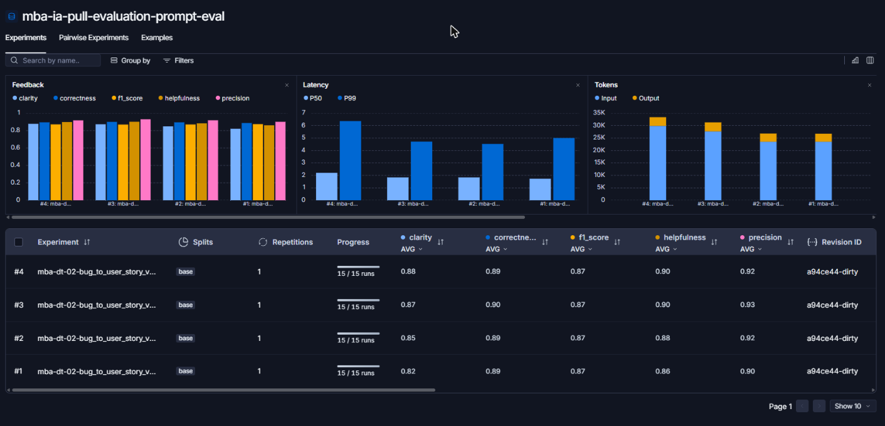

# Pull, Otimização e Avaliação de Prompts com LangChain e LangSmith

Projeto do desafio técnico de **Prompt Engineering** (MBA em Engenharia de Software com IA, FullCycle). O objetivo é transformar relatos de bugs em **User Stories** com critérios de aceitação, partindo de um prompt de baixa qualidade (`leonanluppi/bug_to_user_story_v1`), otimizando-o com técnicas de Prompt Engineering e medindo a qualidade com métricas no LangSmith.

- Prompt otimizado publicado no Hub: `mba-dt-02/bug_to_user_story_v2` (público)
- Dataset de avaliação público (15 exemplos e experimentos): https://smith.langchain.com/public/9e8a132a-b51a-480b-9ac7-d97a6f815332/d

## Resultado em resumo

Todas as 5 métricas ficaram **acima de 0.8** nas três iterações. Resultado final (iteração 3, avaliada por `gpt-4.1`):

| Métrica | Nota | Status |
|---|---|---|
| Helpfulness | 0.90 | ✓ |
| Correctness | 0.90 | ✓ |
| F1-Score | 0.88 | ✓ |
| Clarity | 0.88 | ✓ |
| Precision | 0.92 | ✓ |
| **Média** | **0.8965** | **Aprovado** |

## Técnicas Aplicadas (Fase 2)

O prompt otimizado está em [`prompts/bug_to_user_story_v2.yml`](prompts/bug_to_user_story_v2.yml). Foram combinadas quatro técnicas, listadas nos metadados (`techniques_applied`) do YAML.

### 1. Role Prompting
**Por quê:** o v1 dizia apenas "você é um assistente", sem especialidade nem público-alvo. Uma persona específica orienta o vocabulário e o nível de detalhe da resposta.

**Como foi aplicado:** o system prompt abre com a persona *"Você é um Product Manager sênior com 10 anos de experiência em produtos digitais (e-commerce, SaaS, ERP, CRM e apps mobile)"* e define o que ela entrega: User Stories claras, testáveis e prontas para o backlog.

### 2. Few-shot Learning (obrigatório)
**Por quê:** os juízes comparam a resposta com uma referência em um formato específico ("Como um… eu quero… para que…", critérios Dado/Quando/Então e seções extras). Descrever o formato não basta; exemplos mostram o padrão exato.

**Como foi aplicado:** três exemplos de entrada e saída no system prompt, cada um cobrindo uma situação diferente:
- **Exemplo 1, relato simples:** botão "Salvar rascunho" que não funciona. Saída com User Story e 5 critérios, sem seções extras.
- **Exemplo 2, relato com detalhes técnicos:** exportação CSV com HTTP 504. Saída com "Contexto Técnico".
- **Exemplo 3, bug de segurança com perfis diferentes:** acesso a relatório premium por URL direta. Saída com "Critérios Adicionais para Assinantes Premium" e "Contexto de Segurança".

Os exemplos foram escritos do zero e **não repetem nenhum dos 15 casos do dataset**, para não vazar o gabarito.

### 3. Chain of Thought (interno)
**Por quê:** converter um bug em User Story exige decidir quem é afetado, o que essa pessoa quer e como saber que o problema foi resolvido.

**Como foi aplicado:** a seção "Processo de raciocínio" traz 5 perguntas em ordem (quem é afetado, o que deseja, por que importa, o que comprova a correção, qual a complexidade do relato), com a instrução de **não escrever o raciocínio na resposta**, porque os juízes avaliam o texto inteiro e raciocínio extra reduziria a Precision.

**Limite honesto:** o modelo de geração (`gpt-4.1-mini`) não é um modelo de raciocínio. Sem escrever os passos, essa técnica funciona mais como uma lista de checagem do que como raciocínio explícito. Ela foi mantida por ser barata e não prejudicar as métricas, mas não foi medido o ganho isolado dela.

### 4. Skeleton of Thought
**Por quê:** respostas com estrutura fixa são mais fáceis de ler (Clarity) e de comparar com a referência (F1).

**Como foi aplicado:** o prompt define um esqueleto obrigatório (persona, objetivo e benefício na primeira linha; bloco de critérios; seções opcionais) e regras para quando incluir cada seção extra: "Contexto Técnico", "Contexto de Segurança", "Critérios Técnicos", "Exemplo de Cálculo", "Critérios Adicionais" e "Impacto Business". Relatos complexos usam blocos rotulados ("A. Performance:", "B. Consistência de dados:").

### Uso de System vs User Prompt
- **System prompt:** persona, processo, formato, regras, casos especiais e exemplos.
- **User prompt:** apenas a tarefa e a variável `{bug_report}`, que no v1 estava duplicada nos dois lugares.

### Tratamento de edge cases
O prompt trata explicitamente: relato vago ou incompleto, relato com vários problemas, relato que não é bug (pedido de funcionalidade), relato em outro idioma, valores esperados citados no relato e proibição de inventar tecnologias, números ou causas.

## Resultados Finais

### Evidências no LangSmith
Link público do dataset de avaliação, que expõe os experimentos: https://smith.langchain.com/public/9e8a132a-b51a-480b-9ac7-d97a6f815332/d

| Evidência | Screenshot |
|---|---|
| Dataset de avaliação com os 15 exemplos | [`docs/01-dataset-15-exemplos.png`](docs/01-dataset-15-exemplos.png) |
| Comparação dos 4 experimentos (notas, latência, tokens) | [`docs/02-experimentos-comparacao.png`](docs/02-experimentos-comparacao.png) |
| Notas por exemplo, iteração 3 | [`docs/03-notas-por-exemplo.png`](docs/03-notas-por-exemplo.png) |
| Trace 1: carrinho com produto fora de estoque | [`docs/04-trace-carrinho-fora-de-estoque.png`](docs/04-trace-carrinho-fora-de-estoque.png) |
| Trace 2: pipeline de vendas com desconto | [`docs/05-trace-pipeline-desconto.png`](docs/05-trace-pipeline-desconto.png) |
| Trace 3: checkout com múltiplas falhas (complexo) | [`docs/06-trace-checkout-complexo.png`](docs/06-trace-checkout-complexo.png) |



Os traces mostram entrada, saída, modelo usado, tempo e as 5 notas gravadas como feedback. O trace 1 é o exemplo de **pior nota** da iteração final (F1 0.69) e foi incluído por mostrar uma limitação real do prompt.

### Evolução por iteração

Todas as avaliações usaram o mesmo dataset de 15 exemplos. Modelo de geração: `gpt-4.1-mini`.

| Iteração | Commit no Hub | Juiz | Helpfulness | Correctness | F1 | Clarity | Precision | Média |
|---|---|---|---|---|---|---|---|---|
| 1 (linha de base) | `a360c4db` | `gpt-4.1-mini` | 0.86 | 0.89 | 0.87 | 0.82 | 0.90 | 0.8681 |
| 1 (reavaliada) | `a360c4db` | `gpt-4.1` | 0.88 | 0.89 | 0.87 | 0.85 | 0.92 | 0.8827 |
| 2 | `5d893233` | `gpt-4.1` | 0.90 | 0.90 | 0.87 | 0.87 | 0.93 | 0.8939 |
| 3 (final) | `7b1000ef` | `gpt-4.1` | 0.90 | 0.90 | 0.88 | 0.88 | 0.92 | **0.8965** |

A reavaliação da iteração 1 com o juiz mais forte foi feita para que as comparações seguintes fossem entre o mesmo juiz. O LangSmith trunca as médias em vez de arredondá-las, então algumas notas do dashboard diferem em 0.01 das do terminal.

### O que mudou em cada iteração

**Iteração 1 → 2.** Diagnóstico: os casos complexos tinham respostas curtas (2 mil caracteres contra 3,6 a 5,8 mil da referência), Clarity de 0.70 a 0.75 e F1 prejudicado por omissões. O limite de 4 a 6 critérios não servia para eles.
- Relatos complexos passam a usar blocos rotulados, sem limite de critérios.
- Cada número, limite, mecanismo e solução do relato deve aparecer na resposta.
- Valores esperados citados no relato são usados exatamente como estão.
- Regra de persona corrigida: "o sistema" cobre bugs de backend e segurança.
- Resultado: média de 0.8827 para 0.8939.

**Iteração 2 → 3.** Diagnóstico: o juiz apontava repetição entre critérios e seções extras. A regra de citar cada solução em "Critérios Técnicos" induzia isso.
- Cada fato aparece uma única vez; as seções extras trazem só o que não está nos critérios.
- "Critérios Técnicos" lista só a solução, em uma linha por item.
- Quando os dados do relato apontam a correção (z-index do modal 1000 menor que o do menu 1050), ela é registrada.
- Blocos de no máximo 5 linhas nos casos complexos.
- Resultado: média de 0.8939 para 0.8965; Clarity dos casos 13 e 15 de 0.70 e 0.75 para 0.85.

### Notas por exemplo, iteração final

| # | Complexidade | Relato | F1 | Clarity | Precision |
|---|---|---|---|---|---|
| 1 | simples | Botão de adicionar ao carrinho não funciona no produto ID… | 1.00 | 0.85 | 0.90 |
| 2 | simples | Campo de email aceita texto sem @… | 1.00 | 0.90 | 1.00 |
| 3 | simples | No iOS, ao girar o celular para landscape… | 1.00 | 0.95 | 1.00 |
| 4 | simples | Dashboard mostra contagem errada de usuários ativos… | 0.80 | 0.93 | 0.93 |
| 5 | simples | Imagens de produtos não aparecem no Safari… | 0.95 | 0.85 | 0.97 |
| 6 | média | Webhook de pagamento aprovado não está sendo chamado | 0.79 | 0.85 | 0.93 |
| 7 | média | Relatório de vendas demora mais de 2 minutos… | 0.82 | 0.85 | 0.83 |
| 8 | média | Endpoint /api/users/:id retorna dados de qualquer usuário… | 0.90 | 0.95 | 0.97 |
| 9 | média | Pipeline de vendas calcula valor total errado com desconto | 0.95 | 0.95 | 1.00 |
| 10 | média | App Android trava ao carregar lista de notificações… | 0.82 | 0.85 | 0.93 |
| 11 | média | Carrinho permite finalizar compra com produto fora de estoque | 0.69 | 0.80 | 0.80 |
| 12 | média | Modal de confirmação de exclusão atrás do menu lateral… | 0.82 | 0.90 | 0.83 |
| 13 | complexa | Sistema de checkout com múltiplas falhas críticas | 0.92 | 0.85 | 0.97 |
| 14 | complexa | Sistema de relatórios gerenciais com problemas severos… | 0.90 | 0.85 | 0.93 |
| 15 | complexa | App de produtividade offline-first com bugs críticos… | 0.84 | 0.85 | 0.85 |

### Comparação entre o prompt original (v1) e o otimizado (v2)

O v1 **não foi avaliado neste projeto**. Os números de exemplo do enunciado (0.45 a 0.52) são ilustrativos, e não medições nossas. A comparação abaixo é, portanto, de conteúdo, e não de notas.

| Aspecto | v1 (original) | v2 (otimizado) | Por quê |
|---|---|---|---|
| Persona | "um assistente que ajuda a transformar relatos de bugs" | Product Manager sênior, com especialidade e domínios | Orienta vocabulário e nível de detalhe |
| Formato de saída | Nenhum ("crie uma user story") | Esqueleto fixo com persona, objetivo, benefício e critérios Dado/Quando/Então | Os juízes e o gabarito exigem esse formato |
| Exemplos | Nenhum | 3 exemplos de entrada e saída (simples, técnico, segurança) | Few-shot é obrigatório e ensina o padrão exato |
| Raciocínio | Nenhum | 5 perguntas internas antes de responder | Guia a identificação de persona, objetivo e critérios |
| Edge cases | Nenhum | Relato vago, múltiplos problemas, não-bug, outro idioma | Evita respostas inconsistentes |
| Regras | Nenhuma | Não inventar dados, usar números do relato, uma vez cada fato | Sustenta a Precision |
| `{bug_report}` | Duplicado no system e no user prompt | Só no user prompt | O relato chegava duas vezes ao modelo |
| Relatos complexos | Sem tratamento | Blocos rotulados e cobertura de todos os pontos | Casos 13 a 15 do dataset |

## Observações e limitações

- **Os juízes também são LLMs.** O juiz da avaliação final é o `gpt-4.1`, mas gerador e juiz são da mesma família, o que pode favorecer o estilo do gerador. A variação por exemplo entre rodadas chega a ±0.10; a média dos 15 exemplos é mais estável que cada linha.
- **Uma rodada por versão.** Cada iteração foi avaliada uma vez. Diferenças de 0.01 a 0.02 entre iterações estão dentro do ruído esperado.
- **Omissões que o relato não permite corrigir.** A F1 mais baixa (exemplo 11, 0.69) vem de critérios que a referência traz e o relato não menciona (por exemplo, reserva temporária de estoque). Pedir esses itens ao modelo exigiria inventar informação e derrubaria a Precision.
- **Mapeamento das notas.** O `evaluate.py` imprime as notas na ordem de execução, não na ordem do dataset. Para analisar um exemplo, as notas foram cruzadas pelo texto do relato.
- **Prompt público.** O prompt v2 está público no Hub. O handle `mba-dt-02` é definitivo.

## Como Executar

### Pré-requisitos
- Python 3.10 ou superior. Foi usado o **Python 3.13**; o 3.15 ainda não tem pacotes prontos para dependências como `zstandard`.
- Conta no [LangSmith](https://smith.langchain.com) com uma API key e um **handle público** do Prompt Hub (criado ao tornar um prompt público pela primeira vez, definitivo depois de confirmado).
- Uma API key da OpenAI (ou do Google Gemini).

### Instalação
```bash
git clone https://github.com/marcellinho47/MBA-DT-02.git
cd MBA-DT-02

python -m venv venv
source venv/bin/activate      # No Windows: venv\Scripts\activate
pip install -r requirements.txt
```

### Configuração
Copie o template e preencha as variáveis:

```bash
cp .env.example .env
```

| Variável | Valor usado neste projeto |
|---|---|
| `LANGSMITH_API_KEY` | sua key do LangSmith |
| `LANGSMITH_PROJECT` | `mba-ia-pull-evaluation-prompt` (define o nome do dataset: `{projeto}-eval`) |
| `USERNAME_LANGSMITH_HUB` | seu handle do Hub |
| `LLM_PROVIDER` | `openai` |
| `OPENAI_API_KEY` | sua key da OpenAI |
| `LLM_MODEL` | `gpt-4.1-mini` (gera as respostas) |
| `EVAL_MODEL` | `gpt-4.1` (avalia as respostas) |

Escolha modelos que aceitem `temperature=0`, porque as avaliações usam esse valor. Alguns modelos de raciocínio retornam erro 400 nesse caso. Nunca versione o `.env`: ele já está no `.gitignore`.

### Fase 1: pull do prompt original
```bash
python src/pull_prompts.py
```
Baixa `leonanluppi/bug_to_user_story_v1` e salva em `prompts/bug_to_user_story_v1.yml`.

### Fase 2: otimização
Edite `prompts/bug_to_user_story_v2.yml` (persona, formato, exemplos, regras e metadados). Valide a estrutura com os testes:

```bash
pytest tests/test_prompts.py -v
```

São 8 testes: os 6 exigidos (system prompt, persona, formato, few-shot, sem TODO, mínimo de 2 técnicas) e 2 de apoio (estrutura validada por `utils.py` e variável `{bug_report}` no lugar certo).

### Fase 3: push para o Hub
```bash
python src/push_prompts.py
```
Valida o YAML e publica `{seu_handle}/bug_to_user_story_v2` como **público**, com descrição, tags e técnicas. Cada push cria um novo commit; se o conteúdo não mudou, o LangSmith recusa e o script apenas avisa.

### Fase 4: avaliação
```bash
python src/evaluate.py
```
Cria (ou reutiliza) o dataset `{LANGSMITH_PROJECT}-eval`, puxa o prompt do Hub, roda os 15 exemplos como um experimento e grava as 5 notas como feedback. O script imprime o link do experimento. Repita as fases 2 a 4 até que **todas** as métricas fiquem em 0.8 ou mais.

> **Windows:** se o console quebrar ao imprimir `✓` ou `❌` (erro `UnicodeEncodeError` com cp1252), execute com `PYTHONUTF8=1`, por exemplo `set PYTHONUTF8=1` no cmd ou `$env:PYTHONUTF8=1` no PowerShell.

### Link público do dataset
```python
from langsmith import Client
print(Client().share_dataset(dataset_name="mba-ia-pull-evaluation-prompt-eval")["url"])
```
Cada chamada gera um endereço diferente; rode uma vez e guarde o resultado.

## Estrutura do projeto

```
.
├── .env.example                  # Template das variáveis de ambiente
├── requirements.txt              # Dependências Python
├── README.md                     # Esta documentação
├── docs/                         # Screenshots das evidências no LangSmith
├── prompts/
│   ├── bug_to_user_story_v1.yml  # Prompt original, puxado do Hub
│   └── bug_to_user_story_v2.yml  # Prompt otimizado
├── datasets/
│   └── bug_to_user_story.jsonl   # 15 relatos de bug com User Story de referência
├── src/
│   ├── pull_prompts.py           # Pull do Hub
│   ├── push_prompts.py           # Validação e push para o Hub
│   ├── evaluate.py               # Avaliação automática (fornecido)
│   ├── metrics.py                # Métricas com LLM como juiz (fornecido)
│   └── utils.py                  # Funções auxiliares (fornecido)
└── tests/
    └── test_prompts.py           # Testes de validação do prompt
```

`evaluate.py`, `metrics.py`, `utils.py` e o dataset não foram alterados.

## Como as métricas são calculadas

O `evaluate.py` chama três juízes por exemplo e deriva as outras duas notas:
- **F1-Score, Clarity e Precision:** notas de 0 a 1 dadas pelo LLM juiz, comparando a resposta com a referência.
- **Helpfulness:** média de Clarity e Precision.
- **Correctness:** média de F1-Score e Precision.

A aprovação exige **todas** as métricas em 0.8 ou mais, e não apenas a média.
